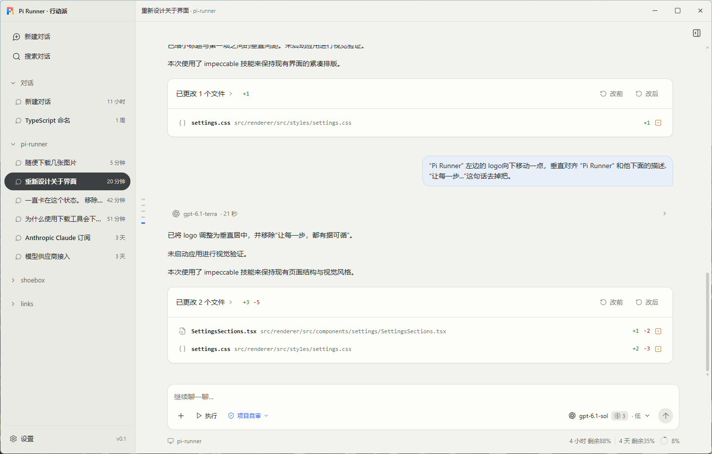
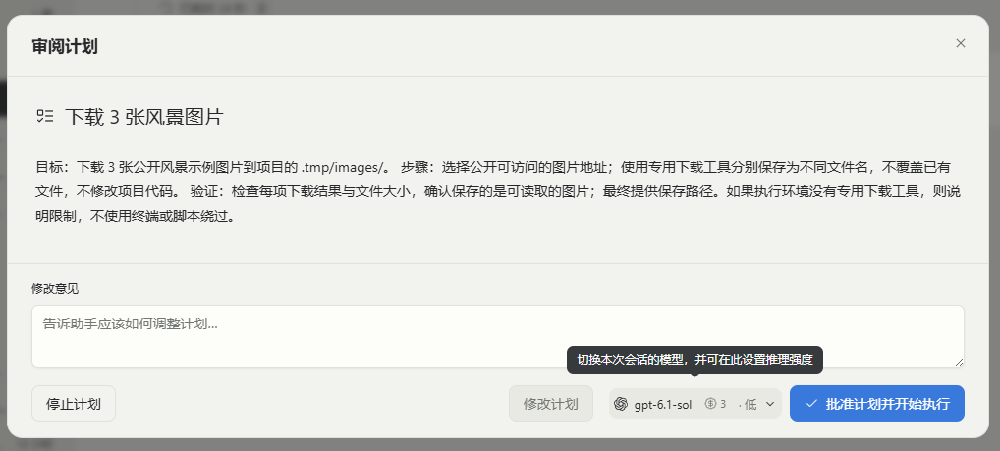
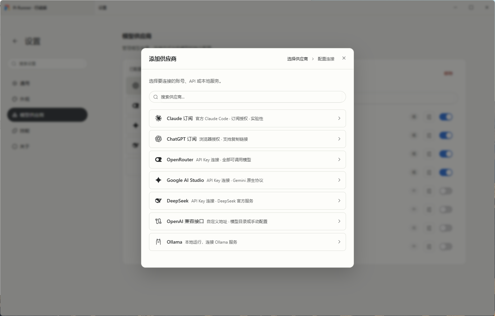
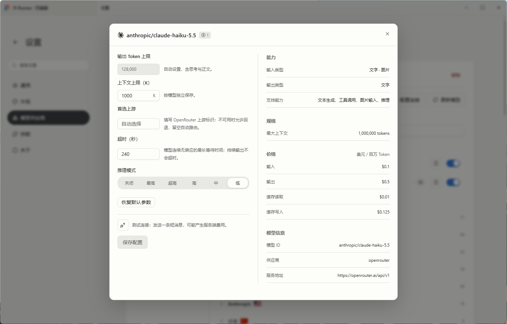
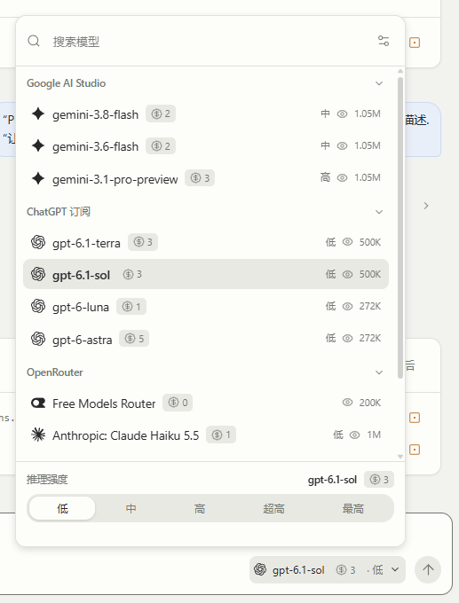
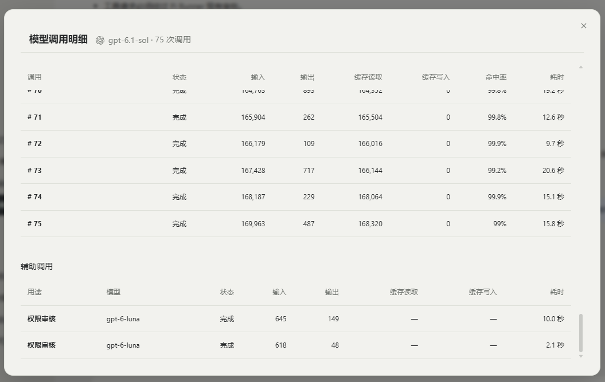
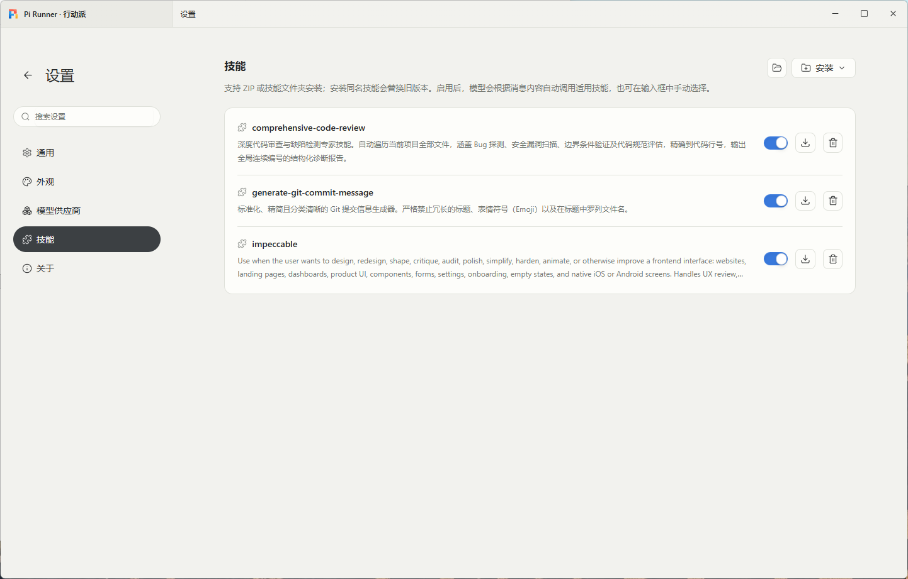
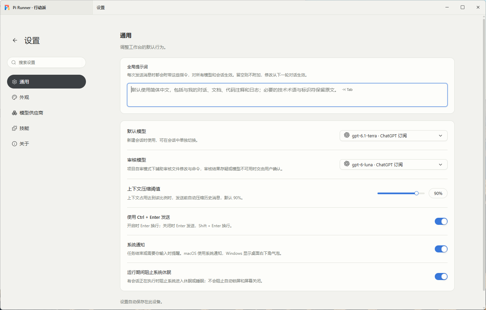

# Pi Runner · 行动派

Pi Runner 是一款本地运行的桌面 AI 编程助手，让 AI 从理解需求、制定计划到操作文件、执行命令，连续完成项目任务。你可以随时查看执行过程、模型调用和文件改动，在效率、成本与控制力之间找到适合自己的平衡。

基于 Electron、React、TypeScript 和 pi-coding-agent，支持 Windows 与 macOS。



## 高效完成任务，而不只是回答问题

用自然语言描述目标，Pi Runner 就能结合项目上下文读取和修改文件、运行命令并反馈结果。流式回复让进度随时可见，支持附件和任务取消；项目对话之外，也可以创建无需选择项目的普通对话。

应用着重精简提示词和减少不必要的模型调用，让执行更聚焦。实际耗时和成本仍取决于任务、模型与服务商。长任务运行时可启用系统通知和防休眠，正式版关闭窗口后也能继续在托盘后台运行。


## 高级模型规划，经济模型执行

复杂任务可以先开启**计划模式**：让能力更强的模型理解需求、必要时向你提问，并生成可审阅的执行计划。你可以提出修改意见；确认计划后，在批准界面切换到价格更低的模型执行，兼顾规划质量与调用成本。

1. 描述目标，按需回答澄清问题。
2. 审阅计划并提出修改意见。
3. 选择执行模型，批准计划后开始执行。




模型切换与不同供应商的计费方式、缓存行为有关，实际费用以供应商账单为准。

## 自由选择模型供应商

支持 OpenAI、Anthropic、Google AI Studio、DeepSeek、OpenRouter、Ollama、ChatGPT 订阅及兼容接口，也提供实验性的 Claude 订阅接入。既可以连接云端服务，也可以使用本地 Ollama，按任务在会话中切换模型和推理强度。



模型配置界面可查看能力、上下文规格与参考价格，并按模型调整参数；模型选择器帮助你在不同供应商和模型之间快速切换。模型及价格信息可能变化，请以供应商最新信息为准。





## 模型调用与缓存，一目了然

查看每次模型调用的状态、输入与输出 token、缓存读取和写入、缓存命中率及耗时，也能查看权限审核等辅助调用。借助明细了解任务的调用过程，识别缓存变化，为选择模型和优化成本提供参考。


对于较长的任务，也可以逐次检查调用及辅助调用；截图中的命中率仅为示例，实际结果取决于模型、供应商与上下文。




## 用 Skill 沉淀可复用能力

将代码审查、提交信息生成等工作方法封装成 Skill，创建或通过 ZIP、文件夹导入本地 Skill。启用后可根据任务内容自动使用，也可以在输入框中手动选择，让常用工作流反复复用。



## 项目自审：在效率与人工控制之间取舍

Pi Runner 提供**每次询问、项目自审、完全访问**三种权限模式。项目自审适合希望减少常规操作打断、同时保留风险审核的可信项目：

- 可读取有权访问的普通文件；项目和系统临时目录内的普通文件修改通常直接执行。
- 已识别的只读查询和常见开发命令可根据命令及参数直接执行；未知命令、项目外目标、全局安装等操作按规则或审核模型判断。
- 审核结果不确定、审核模型不可用、超时或结果无效时，交由用户确认；提权、权限修改等高风险操作仍可能需要人工确认。
- 可在设置中选择、关闭审核模型或使用默认模型。使用模型审核时，需求和待审操作会发送给所选模型服务。



### 安全边界：权限审核不是操作系统沙箱

**沙箱**通常指由操作系统或虚拟化机制隔离程序，限制其文件、网络或系统资源访问的环境。Pi Runner 的权限模式是应用层面的工具规则和操作审核，**不是沙箱，也不提供进程隔离**。

即使在项目自审模式下，获准运行的终端命令、项目脚本、安装钩子及其子进程仍以当前用户的系统权限运行；文件工具的路径保护无法约束这些程序。三种权限模式均不单独限制联网。因此，请只在可信项目中放行开发命令，仔细检查审批内容；需要强隔离时，应另行使用合适的操作系统级隔离环境。

计划模式也不是沙箱：批准计划前禁止写入、下载和执行终端命令；批准后操作仍受当前权限模式约束。完整规则见[权限模式](docs/user-guide.md#权限模式)。

## 改动可追溯，工作台可配置

- **查看与恢复**：使用独立影子 Git 保存项目快照，按轮查看文件差异并恢复文件改动，不修改项目自身的 Git 历史。
- **个性化设置**：配置全局提示词、默认模型、审核模型和上下文压缩阈值，让工作台适应自己的习惯。

## 下载发行版

在本仓库的 **Releases** 页面下载对应系统的版本：

- `pi-runner-setup.exe`：Windows x64 安装包。
- `pi-runner-portable.zip`：Windows x64 便携版，解压到可写目录后运行 `Pi Runner.exe`，无需安装。
- `pi-runner-macos-arm64.dmg`：macOS Apple Silicon（M 系列）版本，打开后将 `Pi Runner.app` 拖入 Applications；不支持 Intel Mac。

Windows 包暂未签名，系统可能提示未知发布者，请确认下载来源。macOS 包暂未进行 Developer ID 签名与 Apple 公证，首次打开可能提示“已损坏”或无法验证开发者，处理方法见[macOS 安装与首次启动](docs/user-guide.md#macos-安装与首次启动)。

维护者推送 `v*` 版本标签即可自动发布，构建版本自动取自标签，无需修改 `package.json`，也可在 Actions 中手动指定已有标签，详见[自动发布说明](docs/development-guide.md#github-自动发布)。

## 开始使用

需要 Node.js 24+、pnpm 12.6.0 和系统 Git：

```sh
pnpm install --frozen-lockfile
pnpm dev
```

启动后，在设置中配置模型供应商和密钥，选择项目或创建普通对话，即可开始。详见[使用指南](docs/user-guide.md)。

正式版关闭窗口后会收进托盘，后台任务继续运行；从托盘菜单选择「退出」才会退出。开发模式关闭窗口则直接退出。

## 安全与数据

会话和快照保存在本机，API Key 使用系统安全存储加密；使用远程模型时，发送的提示词和代码会传给相应服务商。快照不是完整备份：依赖、构建产物、凭证等排除项，以及项目外改动，不在恢复范围内。

工具权限是软件审核，不是操作系统沙箱；终端和子进程仍以当前用户权限运行。请信任项目及其依赖，并检查审批内容。详见[使用指南](docs/user-guide.md#权限模式)和[快照策略](docs/architecture.md#快照策略)。

## 开发与文档

```sh
pnpm typecheck
pnpm test
pnpm build
```

Windows 可使用 `pnpm.cmd`。打包和开发约定见[开发指南](docs/development-guide.md)。

- [使用指南](docs/user-guide.md)：模型配置、计划模式与权限
- [Claude 订阅](docs/claude-subscription.md)：官方 CLI 安装、绑定、计费保护与使用限制
- [开发指南](docs/development-guide.md)：开发、打包与提示词维护
- [技术架构](docs/architecture.md)：进程、数据、快照策略与 LLM 工具
- [模型数据与维护来源](docs/model-data-sources.md)：价格、默认参数、厂商国家及维护依据
